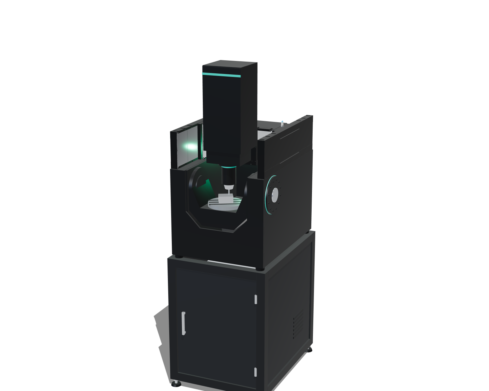

# 2026-11-13 — Concept renders of a 5-axis milling machine

**Role(s):** engineering, marketing

## What happened

The founder drew a 5-axis milling machine that uses AQTUATOR CS stages, and gave its sizes in a
second sketch. We built a 3D concept picture of it for the REFAQT website and checked it
together in six rounds. The pictures, both sketches and a copy of the model are in
[docs/concept-renders/2026-11-13_5-axis-mill/](../concept-renders/2026-11-13_5-axis-mill/README.md).

Main points: 560 mm wide machine on a 600 × 800 mm stand; two CS-520 Y stages on their edge;
a CS-220 X stage on a 160 mm beam; a CS-220 Z stage in a column with an 80 mm spindle; a
cradle (A axis) with a turning table (C axis); a chip pocket that leads into the stand; all
walls 100 mm and black anodised.

## Decisions

- The founder confirmed that this machine is the concept of the Qarve machine.
- These are concept pictures only. No FreeCAD model exists yet, and no requirement was added to
  SysML.
- The model that draws the pictures stays in `refaqt/refaqt-web` (`tools/render-machines.html`).
  This folder keeps a copy, so the pictures can be traced and drawn again.

## Open Questions

- The stand height (800 mm) and the A-axis height (385 mm above the machine bottom) were chosen
  by the agent and are not confirmed.

## Next Steps

- If the design goes ahead: put the sizes in `cad/params/` and the axes in SysML, then draw it
  in FreeCAD.
